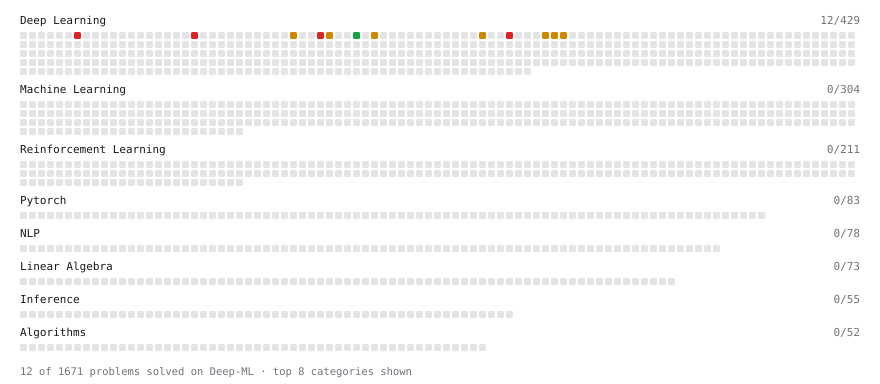

# Deep-ML

My machine learning practice from [Deep-ML](https://www.deep-ml.com). Every solution here was written by hand.

**2** solved · 2 problems · 0 labs · 0 math

[**Browse the interactive portfolio**](https://praline0831.github.io/deep-ml/) to replay this filling in over time.

## Problems

| | Difficulty | Solved | |
| --- | --- | --- | --- |
| [Implement Multi-Head Attention](https://www.deep-ml.com/problems/94) | hard | 2026-10-26 | [solution](problems/0094-implement-multi-head-attention) |
| [Implementing a Custom Dense Layer in Python](https://www.deep-ml.com/problems/40) | hard | 2026-10-26 | [solution](problems/0040-implementing-a-custom-dense-layer-in-python) |

---

_This file is regenerated by Deep-ML on every push._
